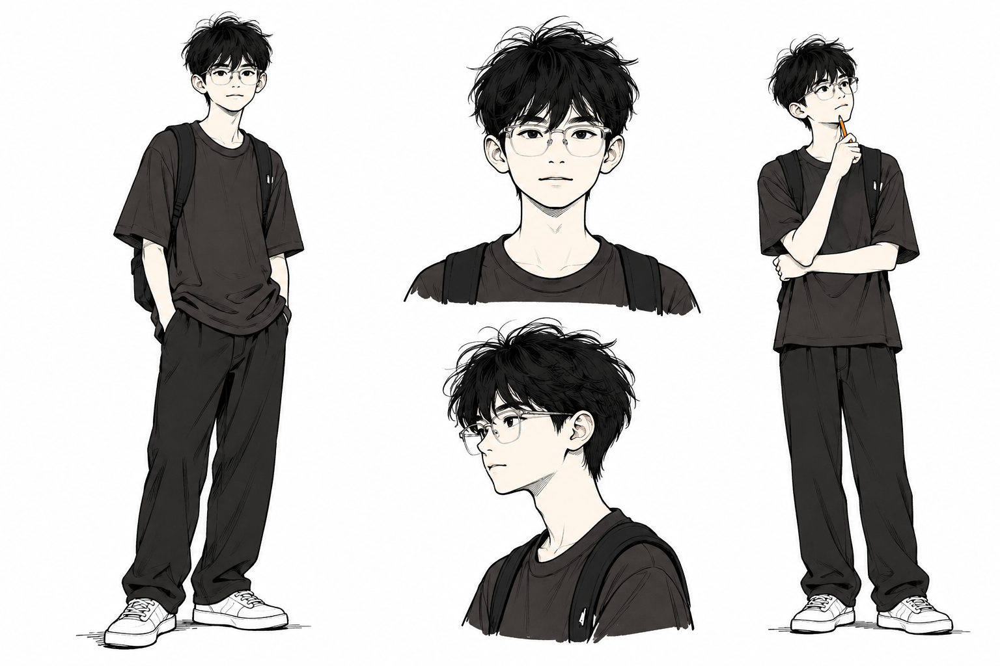

# Jayden Illustrations

使用 Jayden 的个人形象，为中文文章、帖子和工作流内容生成白底手绘正文配图。

角色由用户确认：蓬松黑发、细框眼镜、宽松黑衣、黑色背包。画面保留黑白手绘、少量红橙蓝批注和大量留白；让角色亲自参与文章中的动作和隐喻。

## 角色设定



此图用于固定人物身份，生成时应作为图像参考传给图像工具。正文配图可以简化细节，但应保留发型、眼镜与黑衣。

## 正文示例：对准目标


Jayden 调节望远镜，对准远处的目标；脚边废纸表示干扰。角色设定图和此示例均来自用户已确认的原对话生成图。后续按当前文章设计新隐喻。

## 安装

```bash
git clone https://github.com/jiahao-jayden/jayden-illustrations.git
cd jayden-illustrations
mkdir -p "${CODEX_HOME:-$HOME/.codex}/skills"
cp -R ./jayden-illustrations "${CODEX_HOME:-$HOME/.codex}/skills/"
```

## 使用

```text
Use $jayden-illustrations 为这篇文章生成 4 张正文配图。
使用角色设定图中的 Jayden：蓬松黑发、细框眼镜、宽松黑衣和背包。
要求 16:9 横版、白底手绘、少量中文批注，每张表达一个核心意思。

<粘贴文章>
```

只做规划时说明“先不要生图”，输出每张图的位置、主题、核心意思、角色动作和标注词。更多用法见 [examples/prompts.md](examples/prompts.md)。

## 目录

- `jayden-illustrations/`：需要安装的 Skill，包括角色参考、提示词和检查规则。
- `examples/`：Jayden 版本的示例与调用方式。
- `upstream-examples/`：保留的 Ian 原版样例，用于追溯来源，不属于 Jayden 默认生成参考。

## 来源与许可

本项目基于 [Ian Xiaohei Illustrations](https://github.com/helloianneo/ian-xiaohei-illustrations)，原作者 [Ian / helloianneo](https://github.com/helloianneo)。沿用原项目的手绘配图方法，替换为 Jayden 的个人角色与示例。

原作者署名、原版样例和 MIT 许可证保留。详见 [NOTICE.md](NOTICE.md) 与 [LICENSE](LICENSE)。
